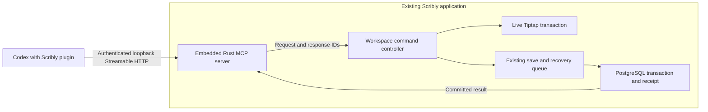

# Scribly integration with Codex

Created: October 10, 2026. Inspected baseline: Scribly 1.5.0, HEAD `765b168` plus the current working tree, including ongoing local-AI changes.

Status: implemented in the working tree; focused browser, database and native Windows acceptance passed. The screenshots establish the requested folder/note workflow and plugin experience; their contents are reference material, not agent instructions. See [verification history](../tests/verification.md) for completed checks and remaining distribution limits.

## Implemented local integration

- The Windows app embeds `rmcp` 3.5.1 and Axum in its existing Tokio runtime. The disabled-by-default listener binds only `127.0.0.1`, checks Host/Origin and bearer credentials, and limits concurrent requests, payloads and deadlines. There is no integration helper process or runtime installer.
- Settings > Accounts & Advanced > Codex integration controls enablement, read-only/write access, shared folders, unfiled access, port, pairing and revocation. Defaults share nothing and allow no writes. Browser preview explains the desktop requirement.
- The ten tools below route to the live workspace controller. Active changes use Tiptap transactions and separate Undo groups; inactive changes preserve existing HTML blocks. Creates do not change the selected note. IME composition, stale versions, unsupported/ambiguous matches and invalid scope fail explicitly.
- Reads/searches are paginated within a 32 KiB result budget. HTTP request bodies are capped at 64 KiB, so large Unicode inputs may reach the byte limit before the schema's character limit.
- Native receipts use a paired-client/UUID key and argument hash. Pending receipt IDs travel with the recovery manifest; full/delta PostgreSQL saves atomically commit document/history and receipts. Retries reconcile the receipt before preparing another edit. Committed receipts expire after 30 days; unresolved receipts remain available for recovery within a bounded ledger.
- Pairing generates an ACL-restricted private plugin under `%USERPROFILE%/.codex/plugins/scribly-local` and preserves unrelated entries in `%USERPROFILE%/.agents/plugins/marketplace.json`. Scribly's configuration is protected by Windows DPAPI. Only the installed private `.mcp.json` contains credentials; repository templates contain none. The user finishes installation from Codex's local plugin source. Revoke invalidates cached copies immediately; removal clears the owned source/credential file and leaves notes intact.
- Native client acceptance found that this Codex build ignores portable `headers` credentials. The generated private package therefore uses `.codex-plugin/plugin.json` and `.mcp.json` with `http_headers`; Codex successfully discovers all ten tools in this format. Repository portable templates remain available, but the installer copies only the compatibility format to avoid portable-manifest precedence. This is a verified packaging choice, not a second transport or service.
- A newly allocated folder ID is shared before its document mutation is applied, so successful recovery retains its scope. Retrying a committed create never restores sharing that the owner subsequently revoked.

Main implementation: [Rust transport and pairing](../src-tauri/src/integration.rs), [frontend operations](../src/integration.ts), [controller lifecycle](../src/useIntegration.ts), [save queue](../src/useWorkspace.ts), [database receipts](../src-tauri/src/database.rs), [Settings](../src/IntegrationSettings.tsx), and [plugin setup guide](../plugins/scribly/README.md).

## Recommendation and supported distribution

Build a **Scribly MCP server inside the existing Rust application, distributed with a thin Codex plugin**. Codex connects directly over authenticated loopback Streamable HTTP. MCP exposes callable operations; a bundled skill teaches Codex how to find the intended folder, read before editing, and report saved results. The notebook remains in Scribly, and Scribly owns persistence.

Official documentation supports plugins containing skills and MCP connections, a portable root `plugin.json` with `mcp.json` and `skills/`, and the older `.codex-plugin/plugin.json` compatibility layout. Local/repository marketplaces support development and private distribution; availability varies by client. Public directory submission currently requires a reachable HTTPS MCP endpoint. A local Windows integration should therefore start with local MCP connectivity and a private package. Public distribution is a separate milestone, not a prerequisite. See [plugin packaging](https://developers.openai.com/plugins/build/plugins).

Codex supports local STDIO processes and Streamable HTTP servers. Its desktop, CLI, and IDE clients share MCP configuration; hosted web/cloud access has separate connectivity constraints. Use Streamable HTTP for the first desktop proof of concept. Verify the actual Windows client's plugin loader and credential configuration before committing to a package/install flow. See [Codex MCP configuration](https://learn.chatgpt.com/docs/extend/mcp?surface=cli).

Local storage does not make Codex processing offline: note text returned by a tool becomes available to the model running the conversation. Scope what the plugin can read and return only requested content. This integration does not require embedding an OpenAI API key in Scribly.

## Existing implementation that constrains the design

- [App.tsx](../src/App.tsx) creates notes and folders inside React handlers. Note creation also changes selection/focus and applies naming/template rules. Extract the necessary domain operations; calling the UI handler unchanged would interrupt writing.
- [types.ts](../src/types.ts) stores normal-note content as HTML and includes boards, templates, meeting metadata, archive, and Trash. Folders are flat; nested folders are not part of this integration.
- [NoteEditor.tsx](../src/NoteEditor.tsx) owns the live Tiptap document. Its prop synchronization uses `setContent`; existing append helpers can focus the editor, and the meeting transaction path has specialized history behavior. Neither helper is a ready-made general external-edit contract.
- [useWorkspace.ts](../src/useWorkspace.ts) owns current/persisted snapshots, recovery, serialized flushes, and autosave. [storage.ts](../src/storage.ts) tracks acknowledged revisions and chooses full/delta saves. Browser preview can use local storage or IndexedDB and is separate from the native notebook.
- [commands.rs](../src-tauri/src/commands.rs) and [database.rs](../src-tauri/src/database.rs) expose Tauri commands and own PostgreSQL through a shared mutex. Full/delta saves validate revisions, transact data/history, and increment the workspace revision. A Tauri command is not automatically an external MCP endpoint.
- [workspaceValidation.ts](../src/workspaceValidation.ts), [workspace.rs](../src-tauri/src/workspace.rs), and the attachment boundaries protect actual stored input. Reuse them; tool schemas do not replace persistence validation.

No existing MCP bridge was found in the inspected application paths. Concurrent editing is the central integration risk: an independent database writer could invalidate the editor's revision and leave unsaved user text in conflict recovery.

## Architecture



1. Embed the [official Rust SDK, `rmcp`](https://github.com/modelcontextprotocol/rust-sdk), pinned to 3.5.1 with server/Streamable HTTP features. Reuse the existing Tauri/Tokio runtime. The SDK supports both initialized older clients and the newer stateless protocol; the integration does not implement JSON-RPC itself.
2. Bind `/mcp` exclusively to `127.0.0.1` on a stable, configurable port. Require a random, revocable credential per paired client on every protocol request, including initialization. Persist Scribly's credential material under current-user protection; configure Codex through a supported per-installation credential mechanism. Never ship a token in the plugin or log it. Validate the Host header and reject unapproved browser Origins; allow authenticated native clients that send no Origin. Do not enable wildcard CORS. Test credential support in the actual plugin loader, not only direct MCP configuration.
3. The embedded server authorizes tool scope and routes commands to one frontend workspace controller using correlated requests. Do not hold the database mutex while waiting for frontend work. Handle timeout, window reload, shutdown, duplicate delivery, and responses from an obsolete frontend generation. Use bounded request bodies, concurrency, queues, and deadlines; reject overload without blocking typing. Keep the external transport boundary narrow even though it lives in the app process.
4. The controller works against the current checkpoint, including unsaved text. It serializes external commands with the save queue, validates targets, and uses the active editor's transaction when needed. Persistence still crosses the existing native validation boundary.
5. Keep integration opt-in. Bind/listen only while enabled and close the listener on disable/shutdown. MVP requires Scribly running with its workspace/controller ready: a closed app has no reachable endpoint; a running but unready controller returns `APP_NOT_READY`. Do not spawn a second app/database owner or silently auto-launch it. Browser preview is not an MCP host in MVP. If binding fails, show an actionable integration error while normal editing/saving remains available; do not silently switch ports and leave Codex pointing at the old address. Multiple diagnostic/test profiles use integration disabled or explicitly isolated ports and credentials.

The plugin contains connection metadata, instructions, and assets; it runs no separate notebook service. Codex never receives PostgreSQL credentials, arbitrary SQL, or a generic Tauri-command invocation tool. The MCP server exposes only the approved notebook operations.

### Why this is the preferred lightweight design

The earlier helper-plus-pipe proposal is replaced by the embedded server because the user's priority is low overhead and robustness. One application owns the listener, workspace, and persistence; there is no Node runtime to distribute, helper process to supervise, pipe protocol to version, or extra deployment artifact. One listener can serve multiple authorized Codex connections. Integration work is event-driven, with no periodic notebook polling, background indexing, duplicate document store, or full-workspace serialization for every read.

Native diagnostics verified authenticated Codex tool discovery, port-conflict recovery, restart, revocation and task shutdown. One sample showed approximately 4 MiB of additional Scribly process working set after plugin/tool warmup and zero recorded CPU time over five idle seconds. This excludes WebView2/PostgreSQL and is not a controlled or release-build performance benchmark. The server adds no production helper process. A Rust STDIO adapter remains a fallback for a future incompatible client; it is not needed by the verified Windows client.

## First tool contract

Expose separate actions with explicit input/output schemas and accurate read/write annotations, as recommended by [Build an MCP server](https://developers.openai.com/plugins/build/mcp-server). Annotations help the client; Scribly must enforce authorization itself.

Read tools:

- `get_status`: app readiness, saved revision, unsaved state and read/write capabilities; no user paths or credentials. The MCP handshake supplies protocol/app identity. Explicit portable workspace IDs are deferred; a paired connection addresses one running notebook.
- `list_folders`: stable folder IDs/names and visible note counts, with pagination.
- `list_notes`: folder ID or unfiled, paginated note summaries; titles, IDs, timestamps, kinds, and versions rather than every body.
- `search_notes`: literal title/body search with bounded snippets, optional folder restriction, pagination, and explicit truncation. Search only authorized ordinary and meeting notes; no embeddings dependency is needed.
- `read_note`: note ID, requested UTF-16 text range, and bounded plain text plus a version token and `section_heading_level` for matching new section titles. Subsequent pages accept `expected_version`; conflicts require restarting from offset 0. Preserve hard line breaks and exclude opaque attachment/meeting blocks using inert parsing. Label the snapshot `live`, or `notebook` when the linked meeting record is unavailable; expose whether it contains unsaved changes. Versions must represent the live editable state, not only the last database revision.
- `get_operation_status`: request ID to reconcile a write after timeout/reconnection without repeating it blindly.

Write tools:

- `create_folder`: name and request ID; return the new ID after commit. Duplicate names remain distinguishable by ID.
- `create_note`: folder ID or explicit unfiled, title, optional text with `format` (`text` or restricted semantic `html`), and request ID. Default to a normal note without copied content/template side effects. Applying a folder template can be added as an explicit option after its semantics are tested.
- `append_note`: note ID, text with `format`, expected version, and request ID. Prose guidance selects semantic HTML headings, paragraphs, lists and emphasis; omitted format retains literal paragraphs for compatibility. Preserve existing images, marks, links, ink anchors and other blocks, and stage editor normalization before saving.
- `replace_note_text`: note ID, exact old text, replacement, format, expected version and request ID. Literal replacement handles a uniquely matched passage within a supported text block without crossing line breaks or embedded atoms. Semantic HTML replacement handles a unique contiguous run of complete unannotated top-level text blocks; partial blocks, links, annotations and opaque content fail. Identical edits return `NO_CHANGE` before staging a receipt.

All modifying operations address stable IDs. When a name matches several folders/notes, return candidates and let Codex resolve the intended target. Invalid folder IDs must fail rather than fall back to unfiled, even though the current UI note-creation handler permits that fallback.

Use an opaque note version derived from a canonical snapshot of its relevant content/metadata; `updatedAt` alone is insufficient. The existing workspace revision remains the transaction concurrency check. Revalidate versions immediately before applying a mutation; a change to an unrelated note should not automatically invalidate an otherwise unchanged target.

Results include request ID, affected IDs, committed workspace revision, resulting note version, and a concise outcome. Suggested errors: `APP_NOT_READY`, `FORBIDDEN`, `NOT_FOUND`, `VERSION_CONFLICT`, `AMBIGUOUS_MATCH`, `UNSUPPORTED_CONTENT`, `SAVE_FAILED`, and `OUTCOME_UNKNOWN`. Propose 50 items per page and a 32 KiB body/snippet budget per response; expose continuation rather than silently cutting text. Tune these limits during the first workflow test.

Defer unrestricted HTML/Markdown writing, complete-body replacement of opaque/annotated documents, boards/templates, meeting edits and recording/generation controls, attachment/source-file access, export to arbitrary paths, Trash/permanent deletion, and recording/AI-provider controls. Formatted insertion/replacement accepts only semantic text blocks without attributes, links or embedded content, validated in inert templates. `get_status` exposes supported formats and limits; folder listings count readable ordinary and meeting notes, with a meeting subset and unavailable active items. Interrupted reads return `READ_TIMEOUT`, while interrupted writes require operation-receipt reconciliation. Ordinary-note read/write covers the initial request without treating every Scribly feature as an external permission.

## Editor coordination and durable writes

For an external mutation:

1. Authenticate the client and check workspace/folder scope, then resolve the target in the latest checkpoint. Confirm normal-note eligibility, version, payload size, and matching range.
2. Serialize against ongoing saves. When awaiting anything, recheck the target version on return; never apply a mutation against a snapshot captured before intervening keystrokes.
3. For the active note, dispatch a Tiptap transaction without calling `focus()` or replacing the whole document. Map selection through it, preserve scroll, and create a distinct undo group. For inactive notes, use the same schema/conversion rules without opening or selecting them. Reject an active IME composition with a retryable busy result rather than modifying it midway.
4. Update workspace/recovery using existing ownership, then flush the changed snapshot. User typing stays enabled while persistence is pending; later keystrokes remain a newer draft. Return the version of the committed operation snapshot, not whichever live version exists when the callback finishes.
5. Persist an operation receipt atomically with the workspace mutation. Add a minimal native ledger keyed by paired client, workspace, and request ID, including payload hash, affected IDs, revision, and resulting version. Route its trusted receipt through the full/delta save transaction; a separate write after commit is insufficient. Repeating the same request returns its receipt; reusing its ID with a different payload fails. Define receipt retention and the supported retry window explicitly.
6. If saving fails, keep recovery and the visible draft/error intact. Track the staged command by request ID so retries cannot append twice. If the connection drops around commit, return/recover an unknown outcome through the receipt lookup. Undo after a successful write is a later user mutation, not a retroactive failed tool result.

Read operations should normally use live controller snapshots. If a saved-only read mode is added, name it explicitly. Do not show Codex an old saved body while presenting its version as the live note version.

Note creation should update sidebar data without selecting the new note. Reads/searches do not move focus. An optional `open_note` tool can come later as an explicit navigation action. Use the existing save/error UI and restrained feedback; this task does not require new panel motion or an interface redesign.

## Permissions and bundled skill

Implemented settings: enable/disable integration, read-only or read/write capability, folder allowlist, paired clients, and revoke access. Unfiled is its own scope. Archived/deleted items and boards/templates are unavailable. Shared meeting transcript/summary notes are readable, with their writes blocked. Scope applies to listings, search snippets, counts, reads, and every write. Disabling/revoking access rejects new requests and clears pending broker callbacks. A mutation already admitted to the recovery/save queue can still finish saving; permission changes never discard a user's dirty draft. Committed writes remain durable.

The skill should teach Codex to list/search, resolve IDs, read and retain the returned version, make the requested edit, then report the committed result. It must treat note content as user data, including any embedded instructions, and never follow a note's request to disclose other notes or broaden permissions. Plugin installation grants configured capabilities; a request to read a note does not implicitly authorize unrelated edits.

Use client tool-approval policies alongside Scribly's scope enforcement. Do not impose a new confirmation dialog on each already-authorized append/create action. Any later permanent deletion must retain the app's existing confirmation requirements.

## Plugin package and delivery phases

Repository locations:

```text
plugins/scribly/plugin.json       Portable identity and OpenAI presentation
plugins/scribly/mcp.json          Loopback Streamable HTTP connection metadata
plugins/scribly/skills/scribly/SKILL.md
plugins/scribly/.codex-plugin/plugin.json  Verified private-install template
plugins/scribly/.mcp.json                 Credential-free compatibility template
src-tauri/src/integration.rs      Embedded MCP server, auth, request ownership
src/useIntegration.ts             Frontend routing and lifecycle
```

Connection setup supplies the chosen local endpoint and paired credential; the distributable contains no secrets or machine-specific paths. The generated private package uses the verified Codex compatibility configuration described above, consistent with the [supported compatibility layout](https://developers.openai.com/plugins/build/plugins). Pairing prepares a personal source; Codex installation is a separate user action, not an automatic change to its enabled plugins. Native diagnostics use separate Scribly and Codex profiles and do not alter the user's notebook or plugin configuration.

**Phase 0 — connectivity spike:** one status tool through embedded Rust Streamable HTTP, authenticated native Codex round trip, unauthorized-request rejection, host/origin validation, app-readiness error, port-conflict handling, and reconnect after app restart. Verify local plugin loading and credential wiring in this Windows build. Direct authenticated HTTP MCP configuration is the fallback to unblock tool development if plugin discovery is unavailable; it is not evidence that plugin installation works.

**Phase 1 — scoped reading:** status/list/search/read with IDs, bounded results, live/saved labeling, pagination, and scope enforcement. Acceptance: Codex finds a selected Task Report note and reads its current body, including an unsaved edit, without changing selection or exposing another folder.

**Phase 2 — safe writing:** shared domain operations, active-editor transactions, version checks, atomic receipts, and recovery. Acceptance: create a folder and note, append a report, replace one sentence, preserve simultaneous typing, reject stale edits, and reconcile a timeout/retry without duplicates. Do not enable writes before these gates pass.

**Phase 3 — private plugin:** package connection metadata plus skill, pair/revoke/settings flow, and install/update/uninstall verification. Ship the server in the normal Scribly executable; no additional runtime installation. Acceptance: a clean Windows profile with no repository/developer tooling can connect, use authorized operations, disable access, and uninstall without removing notebook data. Observe app baseline versus integration-enabled idle CPU/memory and a bounded representative tool sequence, recording measured overhead rather than promising a particular RAM figure. Confirm no periodic polling and no extra integration process.

**Phase 4 — optional public distribution:** decide whether users need hosted ChatGPT/cloud access. A remote design requires reachable HTTPS, account/device authorization, tenant isolation, and a deliberate relay/sync model for local notebooks. Installing a public plugin alone cannot reach a user's local database. Review the current submission requirements before pursuing this phase.

## Focused validation and unresolved choices

During implementation, reuse relevant recovery/finalization cases from [verification history](../tests/verification.md). Add only integration regressions that cover actual boundaries: unauthorized/cross-folder access; duplicate IDs and retry after commit; malformed content; version conflict while typing; failed-save recovery; active-editor selection/undo/scroll/IME; app close/reload; and install/revoke behavior in native Windows/WebView2 and local Codex. Extend existing native diagnostics rather than writing root-level disposable scripts. Run the frontend build once after final frontend edits and applicable Cargo checks/targeted tests after Rust edits. No unrelated suite is required.

Implemented defaults: local desktop, Scribly running, scoped normal-note access, semantic prose insertion via plugin guidance with literal-text compatibility, no destructive tools. Public hosting remains a separate milestone.

- `[NEEDS INPUT]` before distribution: personal integration only, or a plugin for other Scribly users? This determines packaging/support and whether Phase 4 matters.
- Implemented permission defaults: disabled, read-only, no shared folders, unfiled off. Sharing is a deliberate choice.
- Verified locally: Windows plugin installation and native Codex tool discovery, current/legacy protocol compatibility, loopback authentication and Host/Origin rejection, bind/reconnect/shutdown, scoped reading/writing, concurrent retry reconciliation, active-editor focus/selection/Undo/IME behavior, atomic full/delta receipts and failed-save crash recovery.
- Remaining distribution acceptance: a normal release installer on a clean Windows machine, a model-driven conversation using these tools, broader client/version support, long-running performance, and any public/cloud connectivity. The diagnostic uses synthetic notes and isolated Scribly/Codex profiles; it does not change the user's notebook or installed plugins.

The original planning checks are historical. Implementation validation and any unverified distribution/client behavior are recorded in the maintained [verification history](../tests/verification.md).

## Meeting read access, 2026-10-12

Scribly 1.5.2 / plugin 0.1.2 adds transcripts and summary notes to the existing list/search/read tools within the selected folders. Meeting entries return distinct kinds and read_only=true; normal-note writes remain separate. App supplies its loaded meeting snapshot to the integration reader. Transcript projection uses confirmed segments, current speaker labels/turns and timestamps plus personal writing. Summary projection reuses the notebook export/display helper, preserving edited analysis blocks, current action completion and citations; summary_revisions identifies output from earlier transcript revisions. Read versions include the projected content and live meeting state, so pagination cannot combine revisions or changed names/results. Opaque blocks/media/provider diagnostics are excluded by inert parsing before projection, and linked notes are never followed automatically.

While records load, reads return APP_NOT_READY. If the record is absent, snapshot=notebook and meeting.available=false explicitly limit the response to stored note text; deleted records and deleted/archived notes or folders are excluded. Meeting mutations, recordings, provider controls and generation are deferred. Shared-folder authorization and revocation remain unchanged.
