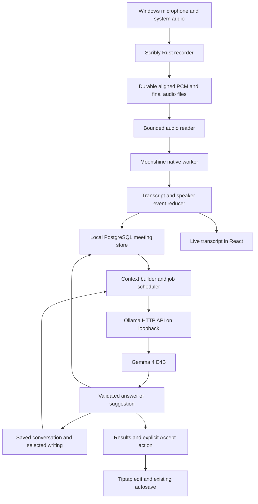

# Scribly local AI architecture and integration plan

Setup update, 2026-10-20: Settings → Accounts & Advanced → Local AI now includes **Set up Gemma 4**. This explicit action reuses the configured running Ollama service, or starts an installed Windows CLI at the default loopback address. If Ollama is missing, it downloads the official Windows installer, requires a valid Authenticode signature from Ollama Inc., and installs it for the current account. The model is downloaded through Ollama's streaming pull API only when `gemma4:e4b` is missing, then inspected for local text-generation capability before selecting it. The meeting-notes provider and other preferences remain unchanged. Existing models/services are not deleted, unloaded, or stopped. This supersedes the initial-release setup restriction below; inference still uses an external, user-owned Ollama service rather than a runtime bundled inside Scribly.

Setup exposes stage/byte progress, status after reopening Settings, cancellation and explicit retry. Stopping during runtime installation takes effect after that atomic installer step; stopping a model pull closes that request, with partial-download reuse handled by Ollama on retry. Custom loopback services can receive the model pull when available; automatic runtime installation/startup uses only the default `http://127.0.0.1:11434` address. The current E4B download is approximately 10 GB; the UI advises at least 20 GB free for a fresh setup including Ollama. This is space guidance, not a measured hardware-performance guarantee. No download occurs automatically on app launch. [Ollama Windows installation](https://docs.ollama.com/windows), [model/API documentation](https://ollama.com/library/gemma4:e4b), [Gemma 4 Apache 2.0 license](https://ai.google.dev/gemma/apache_2). The model weights are downloaded on demand, not redistributed in Scribly's installer. Current checks and native activation limits are in `tests/verification.md`.

Implementation and release-gate record · 9–10 October 2026 · inspected baseline: Scribly 1.5.0, `765b16805d677a79ca3d98f48aeca99bb2f2872c` plus the current working tree.

**Scribly owns capture, saved evidence, conversation history, and editing. Moonshine owns speech recognition and optional speaker diarization. Ollama serves Gemma 4 E4B for text generation.** Model processes are workers; restarting or unloading them must not erase the user's work.

The local provider, native speech worker, durable conversation ledger, recovery, and reviewed writing suggestions are now implemented in the working tree. The architecture below remains the intended contract; implementation evidence and open release gates are recorded in section 13 and `tests/verification.md`. Existing cloud choices remain available through explicit provider selection. This is an experimental local-AI build until the remaining runtime and tokenizer gates pass.

## 1. Scope and defaults

- Windows desktop first, on the supplied Ryzen 5 7535HS / 32 GB laptop. Treat CPU inference as the baseline; Radeon 660M acceleration is an optional measured improvement.
- Moonshine **Medium Streaming, English**, with speaker labels enabled for meetings. Offer Small Streaming as an explicit lighter alternative if the benchmark fails. Do not change models halfway through a recording automatically.
- Ollama's installed **`gemma4:e4b`**, called through Rust over loopback HTTP. Resolve and record its model digest and quantization instead of assuming the tag permanently identifies the same weights.
- Live transcription runs throughout capture. Automatic summaries and action extraction run after stopping. Writing suggestions and follow-up questions start from an explicit user action in the first release.
- Local inference works offline after model setup. No automatic cloud fallback, background model downloads, whole-notebook context expansion, or automatic rewriting of notes.

Moonshine provides Windows/native and CPU-oriented integrations; it does not run inside Ollama. Medium Streaming English is listed as a 245M-parameter model, but parameter count is not a measured runtime memory requirement. [Moonshine quickstart](https://moonshine-voice.readthedocs.io/en/latest/quickstart/), [available models](https://moonshine-voice.readthedocs.io/en/latest/models/available-models/)

## 2. Component boundaries

**Frontend:** chooses the task, displays partial/final results, exposes cancellation, and applies accepted edits. It does not open model files, call Ollama directly, or manage microphone capture separately from the recorder.

**Rust host:** owns audio offsets, durable writes, source snapshots, provider dispatch, conversation persistence, scheduling, cancellation, validation, and Tauri events. Use the existing `reqwest` and Tokio dependencies for Ollama rather than adding a general AI SDK. Do not hold the shared PostgreSQL/workspace mutex while reading audio, waiting on inference, or streaming tokens.

**Moonshine worker:** a packaged Windows x64 child executable using the native C API, with the supported native runtime dependencies. This isolates native crashes from Scribly. Python may be useful for the initial experiment but is not a production prerequisite. Pin a tested SDK/runtime combination; add the worker and required DLLs to the installer resource pipeline and third-party notices.

The worker copies returned native transcript data before the next call and releases SDK-owned allocations through the documented API. Keep one stream owner and serialize its calls; version-check the header/runtime handshake. [Moonshine C API](https://moonshine-voice.readthedocs.io/en/latest/api/c-api/)

Use a versioned worker handshake and a small typed protocol: framed binary PCM packets with sample offsets on stdin; bounded NDJSON transcript/status events on stdout. Reserve stderr for diagnostics without transcript content. Reject oversized or malformed frames, constrain queues, and terminate only Scribly's own worker during cancellation/shutdown. Start it lazily and release it after recording/finalization, rather than keeping speech models resident all day.

**Ollama:** an external, user-owned service. Scribly connects to it, checks its status, and requests generations. Scribly does not kill the daemon, change global concurrency settings, or unload models used by other applications. The October 20 opt-in setup action can install/start Ollama and pull Gemma as described above; ordinary app startup and inference do not install software or download missing models.

## 3. Audio and live transcription

### Capture once, preserve the recording

Reuse `meeting_recorder.rs` and its recording clock, pause handling, microphone/system capture, PCM recovery files, final audio, and existing size limits. Feed Moonshine from those aligned files using the existing live mixer, adapted to the worker input format. Keep original tracks available for recovery; mixing two tracks is not evidence of speaker identity.

Input is 16 kHz mono audio. Read short windows into bounded buffers and convert PCM16 to the native API's required samples in the worker. Never load a complete recording into RAM. At 16 kHz / 16-bit mono, one raw track consumes about **115 MB per hour on disk**; two tracks consume about 230 MB, before final media and optional video. These are arithmetic storage estimates, not RAM measurements.

Recorder writes take priority over inference. When the worker falls behind, retain unread audio on disk and advance a persisted transcription cursor only after the corresponding final transcript has been saved. Show transcription delay rather than dropping speech. An initial five-second backlog indicator is a proposed UX threshold, not a maximum queue that discards data.

Pauses add no meeting audio time. Worker timestamps must map to that same unpaused timeline so playback, source links, and recovery agree. Changing enabled capture sources must follow current recording constraints; avoid a second microphone stream with a different clock.

### Reduce events into canonical transcript data

Adapt Moonshine's line-start, text-update, line-complete, and speaker-change events into the existing meeting event path. Interim text is transient and excluded from final summaries. Save completed text before announcing it as saved. Coalesce UI updates and batched speaker patches; do not rerender on each audio packet.

Moonshine can revise recent speaker assignments after completing a line. Its documentation distinguishes completed text/timing from mutable speaker assignments and describes a rolling speaker history. Therefore, text completion and speaker stability are separate states. [Moonshine transcription lifecycle](https://moonshine-voice.readthedocs.io/en/latest/using/transcription/)

Extend the transcript schema compatibly:

- Keep existing numeric segment/source IDs permanent. Map a worker-session ID plus provider line ID to the saved segment ID; serialize large native IDs as strings.
- Add optional provider provenance and timed `speakerSpans` within a canonical line. Display derived speaker turns from these spans without splitting or renumbering existing cited source IDs after later patches.
- Retain the legacy single `speaker` field when a line has one speaker; use an unknown/mixed representation when it does not. Analysis receives the spans where attribution matters.
- Make word confidence optional when the provider does not supply it. Update Rust types, frontend validation, and backup readers together; never invent a confidence value.
- Increment transcript revision when text, timing, speaker attribution, or user corrections change. Check revision before publishing any dependent analysis.

For crash recovery, a durable cursor alone cannot restore diarization's in-memory clustering. On worker restart, replay the saved audio from the beginning for the first version, rebuilding its state and reconciling final output by time/provenance rather than appending duplicates. Preserve user corrections and names. Keep any unreconciled replacement as a reviewable candidate. Optimize restart checkpoints only after the SDK supports restoring the necessary state.

### Speaker labels require additional assets

Enable Moonshine's optional diarization pipeline, including its segmentation/embedding models and required timestamp decoder assets. The documented diarization models derive from pyannote Community-1 and total approximately **8.2 MB of downloads**; that number excludes runtime working memory and compute. Native integration must provision these assets explicitly. [Diarization assets and native setup](https://github.com/moonshine-ai/moonshine/blob/main/docs/diarization-models.md)

Use supported options such as `identify_speakers`, `word_timestamps`, and `diarization_model_dir`. Begin with the documented clustering/history defaults and benchmark before tuning them. [Moonshine options](https://moonshine-voice.readthedocs.io/en/latest/api/options/)

Labels are session-scoped “Speaker 1”, “Speaker 2”, etc. They do not identify real people or guarantee accuracy during overlap. Allow explicit rename and attribution correction. User-assigned names take precedence over model guesses; reconciliation must not attach an old name to an uncertain new cluster. Any Gemma name inference from an explicit introduction remains a cited, reviewable suggestion. Cross-meeting voice recognition and persisted voiceprints are out of scope.

### Stop, drain, and recover

Stopping ends capture, drains remaining saved audio, completes pending text/speaker work, persists the final revision, and then permits automatic recap. Keep playback and writing usable while transcription finishes. Replace assumptions in the existing cloud drain timeout with local backlog-aware progress and cancellation. A timeout or worker crash leaves audio and completed transcript intact, with a clearly marked unprocessed range and Resume action; it must not set `liveComplete` prematurely.

## 4. Ollama integration and generated results

Add an explicit `ollama` text provider and `moonshine` transcription choice. Keep provider and model separate in commands and persisted preferences; a model slug alone must not determine the transport. Extend Settings → Accounts & Advanced using existing connection controls: local status, model selection, speech asset status, and a small explicit test.

Use `/api/tags` to discover installed models, `/api/show` for capabilities/template metadata, and `/api/ps` to inspect loaded model/context information. Require a locally available model; reject cloud-backed selections in the offline path. Bind requests to the configured loopback address and restrict redirects so a local task cannot silently become a remote request. [Model metadata](https://docs.ollama.com/api-reference/show-model-details), [running models](https://docs.ollama.com/api/ps)

Send `POST http://127.0.0.1:11434/api/chat` with model, bounded messages, streaming enabled, and explicit generation limits. Use JSON-schema output for recaps/actions and plain text for rewriting. Parse streamed NDJSON incrementally across partial UTF-8/network frames, with bounded output size. Events carry meeting/conversation ID, request ID, and source revision so late responses cannot overwrite newer results. [Ollama chat API](https://docs.ollama.com/api/chat)

Use existing meeting schemas and citation validation where compatible. A recap contains a summary, decisions, unresolved questions, and action items. Each evidence-based claim/action cites stable transcript sources. Action owner and due date are nullable; “not stated” is preferable to invented assignments. Do not silently mark generated actions as completed.

Optionally return up to three suggested next questions alongside a completed answer, such as “What was left undecided?” or “Turn this into a short follow-up email.” Writing results can similarly offer “Shorten”, “Change tone”, or “Suggest the next paragraph”. Clicking a suggestion creates a normal new user turn with the same scoped context; suggestions never send themselves. A suggested question is not a claim that the transcript contains its answer.

Treat transcripts, notes, and retrieved excerpts as evidence, not instructions. Give the first version no tools to read arbitrary files, execute commands, send messages, or edit notes. Validate output before saving it as completed or inserting it. A valid citation proves the source exists, not that the claim is accurate; evaluate groundedness separately.

Failed or malformed output remains a failed attempt with Retry. Do not loop automatically, switch providers, or overwrite a previously valid result. Retain streaming output as an incomplete draft when useful; exclude it from normal follow-up history unless the user explicitly chooses to reference it.

## 5. Memory and follow-up conversations

### Three different meanings of memory

1. **Durable memory:** Scribly's saved transcript, notes, user edits, completed answers, and conversation ledger. This survives app/model restart.
2. **Request context:** the bounded evidence and conversation turns assembled for one generation. Scribly reconstructs it on every request.
3. **Runtime memory:** model weights, speech state, temporary buffers, and Ollama's KV cache. These improve execution but are disposable.

Gemma does not retain a durable chat simply because Ollama remains loaded. Each follow-up sends the relevant previous user messages and final assistant answers again, plus the new question and selected evidence. `keep_alive` controls residency, not conversation persistence. [Ollama residency and concurrency](https://docs.ollama.com/faq)

### Persist a conversation ledger

The current meeting UI displays earlier Q&A, but the inspected analysis backend constructs each request from the current question and transcript rather than a multi-turn history. Introduce an explicit conversation ID scoped to a meeting or note.

Store a small versioned conversation document separately from the large meeting document, using local PostgreSQL and the project's existing per-item persistence approach. It contains ordered message IDs, roles, final text, status, timestamps, provider/model digest, source revision/references, and optional compacted memory. Keep failed/cancelled attempts distinguishable from completed turns. Avoid copying the full transcript into every message; persist source references/hashes and the bounded evidence excerpts needed to explain an answer.

Provide New conversation and Clear history. A meeting conversation includes that meeting by default. A writing conversation includes the selected passage and nearby prose by default. Other notes enter only through explicit attachment or the separately scoped memory feature. Conversations do not share hidden global history.

### Build each turn deliberately

Assemble the request in this order:

1. Task instructions and output schema.
2. Explicit user preferences for this conversation, such as “shorter” or “professional tone”.
3. A bounded recap of older completed turns, if needed, clearly labeled as generated conversation memory.
4. Relevant source excerpts with stable citations and revision metadata.
5. Recent complete user/assistant turn pairs.
6. The new user message.

Example: after “Summarize the meeting”, the user asks “Which of those tasks belong to Sam?” Scribly includes the prior final answer and task evidence; the new request understands “those”. “Make it shorter” in a writing conversation includes the previous final rewrite and current source passage. Restarting Ollama has no semantic effect because Scribly reconstructs this context.

Source facts and generated answers remain distinct. A previous assistant answer is not new evidence. If a transcript is corrected between turns, disclose the revision and rebuild evidence; mark older answers as based on the earlier revision. If an ambiguous follow-up cannot be resolved from the retained history, ask a concise clarification instead of guessing.

### Reasoning policy

For routine rewriting and recaps, start with thinking disabled when the installed model advertises support. A later explicit deeper-analysis option can enable it within the same output budget. Use the model's advertised controls and separate `message.thinking` field; do not rely on brittle text stripping. [Ollama thinking](https://docs.ollama.com/capabilities/thinking)

Do **not** resend previous reasoning traces on ordinary follow-up turns. Google's Gemma guidance specifies final responses for completed turns, with a distinct exception for tool-call continuations; the initial integration has no tool calls. Store final answers and concise structured memory, not raw reasoning. Keep any optional thinking display transient and separate from notes, search, exports, and backups. [Gemma 4 model guidance](https://ai.google.dev/gemma/docs/core/model_card_4)

## 6. Context limits and long meetings

Start with **4,096 tokens of context**, even though the model supports more. Larger contexts increase cache/prefill cost; the model's advertised maximum is not a suitable laptop default. Set the context explicitly per request and validate the actual runner behavior. [Ollama context length](https://docs.ollama.com/context-length)

Initial allocation: at most 2,560 input tokens, at most 1,024 generated tokens, and 512 tokens of safety margin. Input includes instructions, schema, evidence, history, and the current question. Generated thinking, when enabled, shares the output allowance. Enforce an additional byte ceiling on inputs/outputs to bound application allocations.

**Token counting is an implementation gate:** use a tokenizer compatible with the installed Gemma template, including role/control tokens. Character counts are not exact token counts. Validate estimates against Ollama's returned prompt counts on representative English and Unicode inputs. Until that is verified, use conservative byte limits for experiments; do not ship a claim of exact budgeting or rely on implicit server truncation.

When a request is too large, remove redundant evidence, compact older turns, and retain recent complete turn pairs. Keep the current question and explicitly selected passage. If those alone cannot fit, show a scope error and offer a smaller selection. A conversation recap is a bounded derived artifact linked to the messages it covers; regenerate it after editing/deleting covered messages. Compaction loses detail, so reread original evidence for factual claims.

For full-meeting analysis:

1. Snapshot the completed transcript revision and user speaker names.
2. Divide it at utterance/topic boundaries into chunks that fit the complete prompt budget. Overlap boundary context without counting duplicate claims twice.
3. Extract cited decisions/actions/questions from every chunk, recording coverage.
4. Merge compact intermediate results in bounded groups, preserving source IDs and unresolved contradictions.
5. Deduplicate actions without inventing a consensus. Publish only when all required chunks succeeded; otherwise label coverage as partial.

Checkpoint validated chunk results using transcript revision/hash, model digest, prompt/schema version, and context options. Reuse only matching checkpoints. Apply the existing recovery pattern where useful, without inheriting cloud-sized output limits.

For targeted questions, retrieve relevant transcript passages and resolve references using the conversation. Include neighboring turns and report the searched scope. Questions requiring exhaustive coverage—such as “list every commitment”—must inspect every relevant chunk; a keyword hit is not proof of completeness.

Cross-notebook semantic retrieval is a separate feature described in [Local Context Memory](features.md#local-context-memory). It needs an embedding runtime/index and explicit source eligibility; Moonshine and the generation model do not supply that index automatically. Keep it outside the first local meeting release.

## 7. Resource scheduling and cancellation

- One Scribly Ollama generation at a time. Bound the pending queue and coalesce obsolete requests. Do not assume this limits other applications using Ollama.
- During recording, reserve CPU for capture, transcription, persistence, and editing. Defer automatic recap and background memory work. Queue explicit heavy analysis for after stopping in the first version, with a visible Cancel action.
- Load Gemma lazily. Start with a short per-request residency, such as `keep_alive: "2m"`, to balance repeated follow-ups and idle RAM. Avoid preloading it during speech capture.
- Monitor available system RAM and worker lag. Delay starting an LLM job when measured headroom is insufficient; expose a clear waiting state. Derive the threshold from the target-machine benchmark instead of asserting fixed model RAM consumption from download size.
- Keep transcript buffers, output buffers, recent context, and worker queues bounded. Store large audio and checkpoint data on disk. Release temporary context/output allocations after completion.
- Cancellation stops local streaming, rejects late events, and prevents future chunks or edits. Closing an Ollama request is best effort for server compute; verify the installed version's behavior and do not claim immediate RAM reclamation. Cancel pending jobs before starting replacement work.

The supplied machine has 32 GB installed, with roughly 27.3 GB usable in the earlier screenshot and 10.4 GB available at that moment. Gemma's successful terminal reply demonstrates basic inference, not concurrent recording capacity. Measure warm/cold latency, tokens per second, combined working set, system headroom, and diarization cost with Scribly open. Separate disk weight size from runtime allocations and avoid double-counting shared GPU memory.

## 8. Persistence, recovery, and editing

Use PostgreSQL for meeting metadata, canonical transcript, speaker corrections, analyses, conversation documents, and checkpoint references. Use managed filesystem locations for raw/final audio and model assets. Model caches are reinstallable and excluded from ordinary notebook backups.

Keep transactions short. Save completed transcript/revisions and their acknowledged cursor atomically where possible; acknowledge durable file offsets only after persistence succeeds. Batch speaker-only patches without losing their ordering. Interim text and token streams remain ephemeral until finalized. A crash leaves a truthful interrupted state, not a fabricated completed answer.

Extend existing meeting backup versions and validators for provenance/spans/optional confidence and conversation records. Restore must remap meeting, conversation, message, and citation references consistently. Older backups remain readable. Exclude credentials, raw thinking, model caches, and temporary buffers. Conversation retention/deletion follows its parent note or meeting, including Trash and permanent deletion; no orphaned private history.

For writing, snapshot note ID, revision, selected range, and original text before requesting a suggestion. Display the proposed rewrite beside the original. Apply only after Accept and revalidation that the target still matches. If writing changed, refresh or ask for a new target. Insert through one ordinary undoable Tiptap transaction and existing autosave; preserve focus, selection, scroll, editor instance, and independently edited meeting notes. AI jobs never own save success or mutate notes on completion without the established explicit/automatic-note action.

Browser preview remains a preview: show local connection controls as unavailable unless a separate, explicit browser integration is later designed. Do not weaken CSP or expose model endpoints to the browser merely to mimic native behavior. Add deterministic event fixtures for UI work instead of opening real microphone/provider sessions in preview.

## 9. Failure behavior and privacy

- **Speech asset unavailable:** block local live transcription with setup guidance; retain the existing ability to record for later transcription.
- **Speech worker crash/lag:** keep capture and completed text; expose delay/recovery. Rebuild speaker state from retained audio before trusting resumed labels.
- **Ollama absent, busy, or model missing:** retain everything, report the cause, allow explicit retry/setup. No paid fallback.
- **Source changed or job superseded:** do not publish into the new scope. Preserve a previous-revision result only with an explicit stale label.
- **Invalid JSON/citations or exhausted output:** retain a failed/incomplete attempt; never present it as a successful full recap.
- **Storage/disk failure:** expose the failed save immediately and stop capture safely when recording cannot be preserved. Do not continue showing successful saving.

Model setup may access the internet; local audio/text generation does not require it once assets are present. Keep runtime downloads separate from inference, verify downloaded asset hashes, and collect no transcript-bearing logs by default. Include license notices for the exact SDK, speech/diarization weights, and selected Gemma package. Read the actual package licenses rather than inferring all assets share one license.

## 10. Integration map

- `src/meetings.ts`, `src-tauri/src/meetings.rs`: provider identifiers, compatible transcript extensions, revision rules, conversation/result contracts.
- `src-tauri/src/meeting_recorder.rs`, `meeting_live.rs`: reuse capture/clock/files; add worker transport, event reduction, drain, and replay reconciliation.
- New focused native modules such as `meeting_moonshine.rs`, `meeting_ollama.rs`, and `ai_conversations.rs`: isolate transport, context assembly, and persistence from the shell.
- `src-tauri/src/meeting_providers.rs`: explicit provider dispatch, bounded local prompts, shared evidence/result validation, request ownership.
- `meeting_recovery.rs`, `meeting_backup.rs`, `database.rs`: matching checkpoints, migrations, backup validation/remapping, short transactions.
- `src/useMeetings.ts`, `MeetingAIControls.tsx`, `MeetingSettings.tsx`: typed events, follow-up conversation IDs, local setup/status, task cancellation and speaker patches.
- `src/NoteEditor.tsx`, `meetingNotes.ts`, `useWorkspace.ts`: accepted suggestions through existing editing/undo/save semantics; preserve automatic-note deduplication and user edits.
- `src-tauri/tauri.conf.json`, installer/build resources and notices: native worker/runtime packaging. Keep loopback model calls in Rust and preserve frontend CSP.

Names for new modules/commands are proposals; reuse existing boundaries where they keep ownership clear. No unrelated UI redesign, new animation framework, or general agent platform is required.

## 11. Delivery sequence and acceptance gates

**Phase 0 — Prove the hardware/runtime.** Test a pinned Moonshine Windows worker with labels and the installed Gemma through HTTP. Verify assets, stop/drain, thinking controls, structured output, tokenizer/template compatibility, and process cancellation. Benchmark English audio with pauses, two speakers, overlap, accents, and domain vocabulary. Record actual results before setting performance promises.

Include a representative long recording to check whether SDK stream state, speaker history, transcript UI, and persistence remain bounded in practice. Application queue caps do not prove the native runtime's memory stays flat. If it grows materially with duration, resolve that before release rather than hiding it behind periodic restarts that change speaker identity.

**Phase 1 — Local text provider.** Add Ollama status/model selection and cited recap/actions for saved transcripts, including bounded chunking and cancellation. Gate: correct source references, explicit partial coverage, missing-model failures retaining data, and restart persistence. This provides useful local AI before changing live capture.

**Phase 2 — Live local speech and speakers.** Add worker packaging, durable audio reader, mutable speaker patches, names/corrections, finalization, and replay recovery. Gate: microphone plus system audio timestamps match playback; pause time is excluded; worker failure loses no retained audio; replay does not duplicate text or erase corrections; source IDs survive speaker revisions.

**Phase 3 — Follow-up conversations.** Add the ledger, turn reconstruction, context compaction, scoped evidence, and revision handling. Gate: “those tasks” and “make it shorter” work across model/app restart; previous reasoning is absent from new prompts; clearing history and changing sources invalidate derived memory correctly.

**Phase 4 — Writing suggestions.** Add explicit rewrite/continue/follow-up requests and safe Accept. Gate: edits after request cannot be overwritten; one Undo restores the original; selection/focus/scroll and autosave remain correct. Automatic prose suggestions can be considered after measured latency and interruption behavior justify them.

**Phase 5 — Offline release readiness.** Complete asset setup, notices, installer validation, versioned backups, retention/deletion, and user diagnostics. Gate: an installed Windows build works offline with cached models, and a restored backup preserves citations/history while existing cloud selections and older records remain usable.

Validation stays focused: consult `tests/verification.md`, select existing affected cases, add regression coverage for persistence/citation/cancellation failures, and run the required build/check only when code changes. Native capture, sidecar, and real-model behavior need actual Windows testing; browser fixtures cannot certify them.

## 12. Decisions still requiring measured evidence

- **[NEEDS INPUT — runtime evidence]** Medium Streaming plus diarization real-time capacity and speaker accuracy on this laptop. Initial proposed target: processing faster than incoming audio, with comfortable headroom; measure transcript delivery latency and backlog rather than claiming “zero latency”.
- **[NEEDS INPUT — runtime evidence]** Gemma warm/cold response latency and RAM with 4K context, plus a reasonable minimum free-memory threshold. Larger context is an opt-in measured change.
- **[NEEDS INPUT — implementation evidence]** Exact tokenizer/template agreement and installed-build offline acceptance. Pinned Windows ABI/DLL loading, real native generation and app-side cancellation have been exercised; cancellation does not guarantee immediate Ollama server unloading.
- **[NEEDS INPUT — product evidence]** Accent/language needs beyond English and whether speaker labels are reliable enough for the user's meetings. Until evaluated, expose uncertain labels and correction rather than guaranteeing identity.

These are implementation/benchmark gates. They do not prevent drafting or beginning the isolated local-provider work; they prevent publishing unverified performance and accuracy promises.

## 13. Implemented behavior and setup

The implementation adds `meeting_moonshine.rs`, `meeting_ollama.rs`, `ai_conversations.rs`, `ai_writing.rs`, and `local_ai_resources.rs` behind native IPC. It preserves the existing recorder, notebook save path, cloud selections, and browser CSP. New installations default to local providers; existing saved cloud choices and older credential files retain their provider defaults.

### Use local AI

1. Start the independently installed Ollama service with `gemma4:e4b` available. Scribly lists installed models; it does not pull a model or terminate the user's service.
2. Open Settings > Accounts & Advanced > Local AI. Choose Ollama and the local text model, check local services, and test local text. A cold-load test records machine-specific free-memory headroom; a warm response is labeled separately.
3. Explicitly install Medium English or Small English assets. The pinned Moonshine Voice 0.1.5 Windows x64 runtime/worker is packaged with the app. Setup verifies model file sizes and upstream CRC32C checksums, and the build script verifies the runtime wheel's SHA-256. Those checks have different integrity properties; model weights do not have a fabricated upstream SHA-256 pin.
4. Select local transcription and record with live transcription enabled, or record without live transcription and transcribe retained audio later. Local imports currently support PCM/float WAV, including channel mixing and 16 kHz normalization; compressed imports require conversion to WAV or an explicitly selected cloud provider.
5. Ask questions in a meeting conversation, or select prose in an ordinary note and choose Writing help. Review original and proposed text before Accept. Closing the dialog cancels its request; one Undo reverses Accept. Editing after the snapshot blocks Accept.

Heavy local text requests wait while capture is active. One generation and one pending request are permitted; queued work can be canceled. Available-memory waiting uses the largest observed cold-load delta for the selected digest plus a policy reserve. This measures changes in system free memory, not exclusive model allocation. Model residency is requested for two minutes, and cancellation is best effort for Ollama server compute.

### Durable evidence and history

The October 10 summary-quality follow-up uses compact text evidence with canonical IDs and validated speaker text ranges. Short recordings are grouped by the actual serialized request allowance; longer recordings retain neighboring context across parts. Summary and key-point extraction now connects replies and explicit corrections, omits incidental chatter, and separates suggestions from commitments. Inference schema properties are serialized with claim text before citations/metadata; normal notebook JSON serialization is unchanged. Every part participates in bounded hierarchical reduction and one final synthesis for the whole recording (at most eight summary or twelve key-point items). Old extraction/merge checkpoint keys are superseded. If safe reduction cannot finish, previous notes remain available instead of publishing disconnected group summaries.

For a saved, completed transcript, Fix > Suggest cleanup uses the selected local model and a bounded set of nearby turns. Optional known terms are vocabulary hints, not evidence that a word was spoken. The suggestion and brief explanation remain a review draft; Use suggestion then Save changes accepts the edit. Canonical IDs/times stay fixed, the first pre-edit text survives later edits and meeting backups, and Restore original text is available in Fix. Revision checks reject stale reviews. This is conservative text cleanup, not a new audio decoder or a guarantee of name/accent accuracy.

Thinking remains disabled for the bounded generation pipeline. A same-prompt Gemma 4 E4B comparison at 4K context/1,024 output tokens completed with thinking off; thinking on exhausted the output allowance and returned incomplete JSON. These cold/warm samples overlapped native compilation, so their wall times are not a controlled throughput benchmark. Reasoning text was not retained. See the maintained verification record for commands, evidence and remaining limits.

Completed speech lines retain canonical numeric citation IDs independently of native line IDs and mutable speaker labels. Speaker audio spans and optional word confidence remain provider metadata. The pinned SDK returned reversed and zero-length word intervals on the synthetic fixture: the adapter drops unreliable optional word alignment and its dependent text-span ranges instead of losing valid text or inventing timestamps. Valid audio speaker spans remain available. Replay preserves human text/name corrections and exposes conflicting replacements for review.

A separate PostgreSQL ledger stores final user/assistant turn pairs, failure/cancellation status, model/digest, source revision/hash and writing evidence snapshots. Thinking fields are never forwarded into UI history or saved. Older complete pairs compact into bounded derived memory; recent pairs remain intact and source changes invalidate the memory's revision. Notebook and meeting backups include scoped history, remap restored IDs, and exclude model caches and credentials. Trash retains history; clearing and permanent deletion remove the related history and derived question artifacts.

All transcript chunks must succeed before a local result is published. Each extraction and bounded merge validates supplied citation IDs. Matching revision, digest, prompt/context, and schema checkpoints can resume interrupted work; partial work stays failed/unfinished rather than appearing as a complete recap. App prompts remain conservatively byte-limited: requested context 4,096, output cap 1,024, observed prompt cap 2,560, with 512 reserved. Exact Gemma tokenizer/template agreement is still an open gate.

### Build and focused verification

Run `scripts/prepare-local-ai.ps1` to download and verify the pinned runtime, compile the Windows x64 C++ worker, check ABI 30000, emit the SDK asset manifests, and copy notices. The normal `npm run package` pipeline calls this preparation before Tauri packaging. Generated runtime/build files and model weights are ignored and are not source-controlled.

`powershell -ExecutionPolicy Bypass -File scripts/test-native-local-ai.ps1 -Speech` runs a fresh diagnostic notebook through the real Windows WebView, PostgreSQL, Ollama and Moonshine. It uses generated two-voice speech and system capture without opening a microphone, checks crash/replay, and reopens the app for persistence and compaction checks. The default debug executable requires a running Vite dev server. Use `-ExecutablePath src-tauri/target/release/scribly.exe` for the built frontend and packaged resources; that run rejects a dev-server URL. A prepared worker and explicitly installed `gemma4:e4b` are required. `-Speech` explicitly installs/verifies Medium and speaker assets; `-SpeechModel moonshine-small` selects Small instead. Diagnostic output stays under ignored `test-results-preview/local-ai-native-*` profiles. Browser cases in `tests/local-ai.spec.ts` cover preview behavior, UTF-8 speaker display/citations, history remapping/reasoning exclusion and concurrent restore/save acknowledgement. Consult the verification history for exact commands, outcomes, measurements, and limits.

The local-AI preview installer is `release/Scribly_1.5.0_local-ai-preview_x64-setup.exe` (77,721,619 bytes), SHA-256 `98a0a6ddb01059d4364e58e9b7b73f1c91e75ab37da2a24024d93d0d005e8e38`. It is a separate unsigned preview package; the published 1.5.0 installer remains unchanged. Building and exercising the release executable does not establish installed-build offline acceptance.

That installer predates the October 10 summary/cleanup follow-up. The follow-up Windows preview is built with `npm run tauri -- build --debug --no-bundle --config .build-local-ai/package-config.json` after the frontend build; its debug executable embeds the built frontend and does not need a Vite server. `scripts/test-native-local-ai.ps1 -SummaryQuality -TranscriptPath <recording.json>` exercises a copy of a saved recording in an isolated notebook, including cross-part synthesis and review-only cleanup persistence/restoration. No microphone or cloud provider is used.

The final release-executable check passed with Small speech, including actual app history import/clearing/repeated import, reviewed writing and Undo, worker crash/replay, restart follow-ups, bounded conversation compaction, derived-question recovery clearing, Trash retention and permanent deletion. Medium was exercised in the earlier native run. The Small synthetic fixture produced eight canonical lines and seven speaker spans; initial transcription and replay took 32.732 seconds combined, including loads, for two passes over 19.5 seconds of generated audio. This is a short functional check, not a sustained latency or accuracy guarantee.

The 20-minute repeated synthetic speech test completed successfully with two speaker indices, but private worker memory grew from about 431 to 636 MiB and processing took 1,402 seconds for 1,200 seconds of audio while release compilation ran concurrently. This does not establish sustained real-time capacity or bounded memory, and the memory-growth gate remains unresolved. No periodic stream restart was added to hide growth or change speaker identity.

**Release gates remain open:** exact tokenizer/template agreement; representative human accents, overlap and domain vocabulary; microphone-plus-system synchronization and sustained real-time headroom; observed SDK memory growth and long-session UI/database capacity; and an installed Windows build tested with all external networking unavailable. Synthetic and source/build checks do not substitute for these gates, and this working tree must not be described as certified for those conditions.
